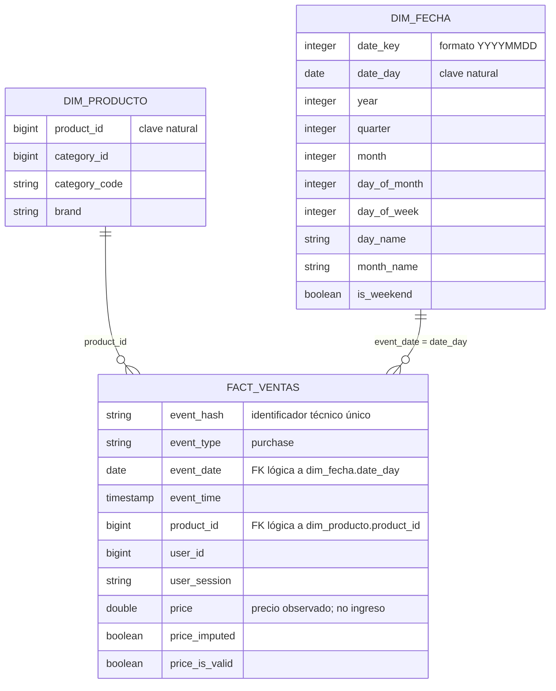

# E2E Lakehouse en AWS

Proyecto de portafolio para construir un lakehouse de punta a punta con
Amazon S3, Apache Iceberg, AWS Glue Data Catalog, Spark y Athena. El repositorio
incluye infraestructura como código, procesamiento de REES46 y consultas para
explorar y validar las capas de datos.

## Arquitectura

```text
REES46 (CSV)
    |
    v
Landing (Parquet en S3)
    |
    v
Bronze (Iceberg, datos de origen y auditoría)
    |
    v
Silver (Iceberg, limpieza, deduplicación y cuarentena)
    |
    v
Gold (Iceberg: fact_ventas, dim_producto, dim_fecha)
```

Landing conserva los datos de origen en Parquet particionado por fecha.
Bronze los registra en Iceberg con metadatos de ingesta. Silver aplica las
reglas de calidad descritas en el
[ADR de limpieza](docs/decisions/001-reglas-de-limpieza.md). Gold contiene el
modelo de hechos `fact_ventas` y las dimensiones `dim_producto` y `dim_fecha`
creadas con dbt en Athena. El esquema y los campos de la estrella se muestran
abajo.

Actualmente Spark se ejecuta localmente y utiliza AWS para acceder a S3 y Glue.
El código de VPC y EC2 es una extensión futura para experimentar con cómputo
distribuido; no es necesario para ejecutar el flujo actual.

## Tecnologías

- AWS S3 para almacenamiento.
- Apache Iceberg y AWS Glue Data Catalog para tablas.
- Apache Spark para ingesta y transformación.
- Amazon Athena para consultas y validación.
- Terraform para infraestructura.
- Python 3.11, `uv` y pytest para el entorno y las pruebas.

## Requisitos

- Python 3.11 y [`uv`](https://docs.astral.sh/uv/).
- Java 17 para Spark.
- AWS CLI y acceso autorizado a la cuenta/región donde se despliega el
  proyecto.
- Terraform para crear la infraestructura. El procesamiento local requiere
  que los buckets y las bases de Glue ya existan.
- El archivo REES46 de octubre de 2019; consulta el alcance y la fuente en
  [Dataset y alcance](#dataset-y-alcance).

No se incluyen credenciales, archivos de estado de Terraform ni datos fuente
en el repositorio.

## Dataset y alcance

La fuente original es
[eCommerce behavior data from multi category store en Kaggle](https://www.kaggle.com/datasets/mkechinov/ecommerce-behavior-data-from-multi-category-store),
publicada por Michael Kechinov con datos de REES46. La página describe siete
meses de eventos, desde octubre de 2019 hasta abril de 2020.

El proyecto procesa actualmente **solo octubre de 2019**, usando
`2019-Oct.csv`. Los resultados de Landing, Bronze, Silver, Gold y los análisis
documentados corresponden a ese mes; noviembre de 2019 a abril de 2020 todavía
no se han incorporado. La página de Kaggle enlaza los archivos mensuales
adicionales alojados por REES46: [octubre de 2019](https://data.rees46.com/datasets/marketplace/2019-Oct.csv.gz),
[noviembre de 2019](https://data.rees46.com/datasets/marketplace/2019-Nov.csv.gz),
[diciembre de 2019](https://data.rees46.com/datasets/marketplace/2019-Dec.csv.gz),
[enero de 2020](https://data.rees46.com/datasets/marketplace/2020-Jan.csv.gz),
[febrero de 2020](https://data.rees46.com/datasets/marketplace/2020-Feb.csv.gz),
[marzo de 2020](https://data.rees46.com/datasets/marketplace/2020-Mar.csv.gz) y
[abril de 2020](https://data.rees46.com/datasets/marketplace/2020-Apr.csv.gz).
La fuente actual no cubre años posteriores; para ampliarse más allá de abril de
2020 hará falta identificar datos compatibles de otra fuente.

Al usar los datos, conserva la atribución indicada por el autor: enlaza la
página de Kaggle y menciona REES46.

## Preparar el entorno local

Desde la raíz del proyecto:

```bash
uv sync --locked --all-groups --python 3.11
```

La plantilla [`.env.example`](.env.example) documenta las variables generales
del proyecto. Para usarla, crea `.env` local e indica allí un perfil AWS ya
configurado en tu máquina:

```bash
cp .env.example .env
```

`AWS_PROFILE` selecciona las credenciales configuradas localmente; no guardes
access keys en `.env`. Ni dbt ni los jobs Spark cargan `.env` por sí mismos.
Antes de ejecutar comandos dbt o Spark, carga explícitamente las variables en
la terminal:

```bash
set -a
. ./.env
set +a
```

Si la infraestructura ya está desplegada, obtén el nombre del bucket desde el
output de Terraform, no desde un valor copiado del README:

```bash
terraform -chdir=infra/data_lake output -raw datalake_bucket
export DATALAKE_BUCKET="$(terraform -chdir=infra/data_lake output -raw datalake_bucket)"
```

Comprueba que la identidad local es la esperada antes de ejecutar jobs:

```bash
aws sts get-caller-identity
```

## Ejecutar y probar

Los comandos se ejecutan desde la raíz para que Spark encuentre los DDL en
`sql/`. El archivo REES46 no se distribuye con el repositorio. Descárgalo de
la fuente enlazada arriba y conviértelo localmente a Parquet particionado:

```bash
uv run python -m ingestion.rees46.csv_to_parquet \
  data/raw/2019-Oct.csv data/landing/rees46
```

La conversión local no escribe en AWS. Para cargar los archivos de Landing a
S3, manteniendo los subdirectorios `event_date=YYYY-MM-DD`, ejecuta:

```bash
aws s3 cp data/landing/rees46/ \
  "s3://${DATALAKE_BUCKET}/landing/rees46/" --recursive
```

Este comando sí escribe en AWS. Confirma la identidad AWS y el bucket destino
antes de ejecutarlo.

Ingesta un día de landing en Bronze:

```bash
uv run python -m spark.jobs.bronze_ingest 2019-10-01
```

El job de Bronze procesa un día por invocación. Invócalo para cada día
presente en Landing antes de reconstruir Silver y la cuarentena desde Bronze:

```bash
uv run python -m spark.jobs.silver_transform
```

Estos jobs modifican tablas en AWS. Revisa el perfil, la cuenta, la región, el
bucket y las tablas destino antes de ejecutarlos; no son comandos de solo
lectura.

Las pruebas locales no necesitan una cuenta AWS:

```bash
make test
```

`make` es un ejecutor de comandos: guarda atajos para las tareas repetidas.
Los targets disponibles (`test` y `sql-lint`) solo ejecutan validaciones
locales; no crean ni destruyen infraestructura.

Para repetir las comprobaciones desde un entorno limpio, instala las
dependencias fijadas y ejecuta:

```bash
uv sync --locked --all-groups --python 3.11
make test
make sql-lint
uv run dbt parse --project-dir dbt_project --profiles-dir dbt_project
uv run dbt compile --no-populate-cache --no-introspect \
  --project-dir dbt_project --profiles-dir dbt_project
```

## Modelo analítico Gold

El proyecto dbt está en `dbt_project/`. `gold.fact_ventas` tiene una fila por
evento `purchase` válido de Silver; `gold.dim_producto` y `gold.dim_fecha`
aportan atributos de producto y calendario. `dim_producto` elige el último
registro observado por producto (SCD tipo 1); `dim_fecha` cubre el rango de
fechas de compra con un calendario continuo. Los tres modelos ya se crearon
en Athena y pasaron las 19 pruebas de dbt.



La granularidad del hecho es una fila por evento `purchase`, no por orden.
Las relaciones del diagrama son claves lógicas verificadas por pruebas dbt;
Glue/Iceberg no declara restricciones físicas de llave foránea. El dataset
[define `price` como el precio del producto](https://www.kaggle.com/mkechinov/ecommerce-behavior-data-from-multi-category-store);
no se debe sumar como ingreso: no proporciona cantidad ni un ID de orden y
varios eventos `purchase` de una sesión pueden pertenecer a la misma orden.

Las consultas de negocio están en [`sql/bi/`](sql/bi/) y cubren actividad
diaria, productos y categorías con más eventos de compra, y etapas observadas
por sesión. El perfil descriptivo de `price` está en
[`sql/analysis/purchase_product_price_profile.sql`](sql/analysis/purchase_product_price_profile.sql).
Los resultados observados y sus limitaciones están resumidos en
[hallazgos analíticos](docs/analytics-findings.md).

Valida y compila dbt sin conectarte a Athena:

```bash
uv run dbt parse --project-dir dbt_project --profiles-dir dbt_project
uv run dbt compile --no-populate-cache --no-introspect \
  --project-dir dbt_project --profiles-dir dbt_project
```

`dbt build` escribe/reconstruye las tres tablas Gold y ejecuta sus pruebas;
puede generar cargos de Athena y S3. Revisa antes el perfil, workgroup y
destinos configurados localmente:

```bash
uv run dbt build --project-dir dbt_project --profiles-dir dbt_project --select fact_ventas dim_producto dim_fecha
```

Las consultas para comparar el modelo con Silver están en
[`sql/verification/gold_fact_ventas.sql`](sql/verification/gold_fact_ventas.sql).
Las verificaciones de integridad referencial de las dimensiones están en
[`sql/verification/gold_dimensions.sql`](sql/verification/gold_dimensions.sql).

## Infraestructura

Terraform está organizado por módulos:

- `infra/bootstrap`: bucket para el estado remoto de Terraform.
- `infra/data_lake`: buckets del lake y de resultados de Athena, bases Glue y
  workgroup.
- `infra/cluster`: red y recursos de cómputo para una etapa futura.

El bootstrap se ejecuta una sola vez. El módulo `infra/data_lake` usa estado
remoto y requiere una configuración local de backend basada en
`infra/data_lake/backend.hcl.example`; completa esos valores para tu entorno
sin subir el archivo local a Git.

Antes de cualquier `terraform apply`, revisa el plan y confirma cuenta,
región, costos y recursos a crear. No se recomienda aplicar el módulo de
clúster como parte del desarrollo local actual.

## Documentación y consultas

- [Estado y siguientes pasos](docs/project-status.md)
- [Hallazgos analíticos de REES46](docs/analytics-findings.md)
- [ADR 001: reglas de limpieza de REES46](docs/decisions/001-reglas-de-limpieza.md)
- [SQL de landing](sql/landing/rees46_events.sql)
- [DDL de Bronze](sql/bronze/rees46_events.sql)
- [DDL de Silver](sql/silver/rees46_events.sql)
- [DDL de cuarentena](sql/silver/rees46_events_quarantine.sql)
- [DDL de auditoría](sql/ops/pipeline_runs.sql)
- [Consultas Athena por propósito](sql/verification/)
- [Consultas de BI](sql/bi/)
- [Análisis descriptivo de precio](sql/analysis/purchase_product_price_profile.sql)

Las consultas de `sql/verification/` son de solo lectura y están separadas
por tema: conteos y comparación de capas, calidad/nulos, cuarentena, snapshots
y métricas de archivos. Los DDL crean tablas; los jobs Spark escriben datos.

Para ejecutar consultas de Athena, selecciona la región en la que desplegaste
el proyecto y el workgroup configurado para el lake. Las rutas S3 de los DDL
deben apuntar a tus propios buckets. En
[`sql/landing/rees46_events.sql`](sql/landing/rees46_events.sql), reemplaza
`your-datalake-bucket` por el nombre devuelto por Terraform.
